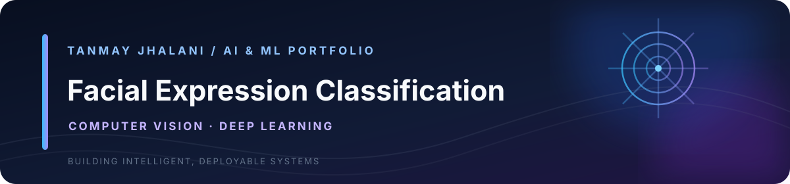

<div align="center">
  
</div>

<div align="center">
  <strong>Designed and engineered by Tanmay Jhalani</strong> · <a href="https://github.com/tanmayjhalani1-ui">GitHub Profile</a>
</div>

---

# Facial Expression Classification

A TensorFlow/Keras CNN project for classifying facial images into the seven FER-2013 dataset categories. The repository includes reproducible training, MLflow experiment tracking, image inference, a Streamlit interface, a FastAPI service, Docker and GitHub Actions CI.

## Features

- Compare two CNN architectures using a validation split
- Class-weighted training to account for class imbalance
- Image augmentation, batch normalization, dropout and early stopping
- MLflow logging for hyperparameters, validation/test metrics and model artifacts
- Shared preprocessing for Streamlit and API inference
- Streamlit dashboard with class probabilities and top predictions
- FastAPI `/predict` and `/health` endpoints
- Docker Compose deployment and CI architecture checks

## Dataset setup

Dataset source: [FER-2013 on Kaggle](https://www.kaggle.com/datasets/msambare/fer2013).

Download and extract the dataset so the directory layout is:

```text
data/
└── fer2013/
    ├── train/
    │   ├── angry/
    │   ├── disgust/
    │   ├── fear/
    │   ├── happy/
    │   ├── neutral/
    │   ├── sad/
    │   └── surprise/
    └── test/
        └── [same seven class folders]
```

The dataset is not committed to Git because of its size and licensing/source terms. The original `dataset` note and `emotion.ipynb` notebook are preserved.

## Local setup and training

```bash
python -m venv .venv
# Windows: .venv\Scripts\activate
# macOS/Linux: source .venv/bin/activate
pip install -r requirements.txt
python -m src.train --epochs 30 --batch-size 64
streamlit run app.py
```

Training reserves 15% of the training folder for validation and uses the supplied test folder for final evaluation. The selected architecture is chosen using validation accuracy. Generated model and metadata files are written to `artifacts/` and are excluded from Git.

## MLflow tracking

```bash
mlflow ui --backend-store-uri ./mlruns
```

Open `http://127.0.0.1:5000`. Each CNN candidate is logged as a separate run in `facial-emotion-recognition`. Runs include training configuration, metrics and model artifacts. These are experiment runs, not registered Model Registry versions; registry promotion and rollback are not configured.

## FastAPI

```bash
uvicorn api.main:app --host 0.0.0.0 --port 8000
```

- `GET /health`
- `POST /predict` — multipart image upload in the `file` field (PNG/JPEG)

API documentation: `http://127.0.0.1:8000/docs`.

## Docker

Train the model first, then launch the Streamlit application:

```bash
docker compose up --build
```

Open `http://localhost:8501`.

## Repository structure

```text
├── api/
│   └── main.py
├── src/
│   ├── train.py
│   └── inference.py
├── artifacts/              # generated model; gitignored
├── data/                   # downloaded dataset; gitignored
├── app.py
├── emotion.py              # original app, preserved
├── emotion.ipynb           # original notebook, preserved
├── dataset                 # original dataset source note
├── Dockerfile
├── docker-compose.yml
└── requirements.txt
```

## Responsible-use limitations

FER-2013 is a small, noisy, class-imbalanced benchmark with low-resolution grayscale images. Its labels represent dataset annotations, not ground truth about a person's internal emotional state. Facial appearance alone cannot reliably establish what someone feels. This project is intended for educational experimentation and model evaluation, not hiring, policing, healthcare, surveillance, or consequential decisions. Performance on real-world images may differ substantially from benchmark results.
